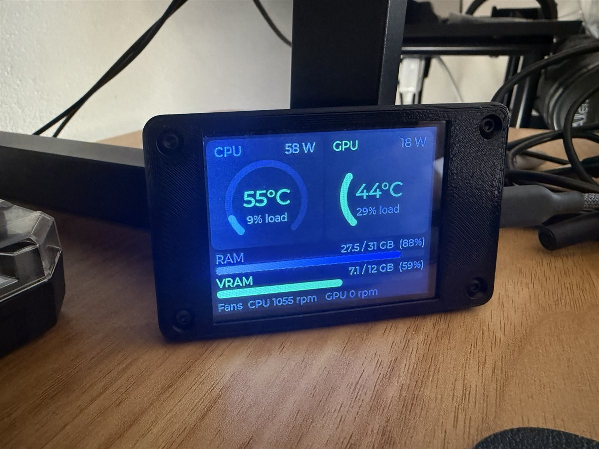

# ESPHome CYD PC Monitor

[](https://github.com/nyburglar/esphome-cyd-pc-monitor/actions/workflows/build.yml)
[](LICENSE)

A live PC hardware monitor on the ESP32 **"Cheap Yellow Display"** (CYD). It shows CPU and GPU temperature, load and power, RAM and VRAM usage, and fan speeds, all sent over the USB cable that powers it. It doesn't use Wi‑Fi, Home Assistant or the cloud.

<!-- Add a photo of your CYD here: save it as docs/images/cyd.jpg and uncomment the next line.

-->

## Features

- **CPU and GPU cards**: a load gauge, a temperature that turns green, then amber, then red as it rises, and power draw in watts
- **RAM and VRAM bars**: used / total GB and percent
- **Fan speeds** for the CPU and GPU, in RPM
- **USB only**: the cable that powers the display also carries the data
- **Ready-made firmware** for all three CYD display controllers, flashed from your browser with nothing to install
- **One-line installer** for the PC side, which starts hidden at every login
- **Fails gracefully**: a "Waiting for PC" box appears when data stops, and the backlight dims after a minute

## What you need

| | |
|---|---|
| **Display** | ESP32-2432S028 "Cheap Yellow Display", 2.8" 320×240. Any revision: micro-USB only, or micro-USB + USB‑C. |
| **Cable** | A USB **data** cable. Use USB‑A to micro-USB or USB‑A to USB‑C, because many CYDs don't work with C‑to‑C cables. For mounting inside the case, a "USB 2.0 9‑pin header to micro-USB/USB‑C" cable works. |
| **PC** | Windows 10 or 11 with [Python](https://www.python.org/downloads/) 3.9 or newer |
| **Sensors** | [LibreHardwareMonitor](https://github.com/LibreHardwareMonitor/LibreHardwareMonitor) (free), needed for CPU temperature, CPU power and fan speeds |

## Quick start

### 1. Flash the firmware

1. Download a `.factory.bin` from the [latest release](https://github.com/nyburglar/esphome-cyd-pc-monitor/releases/latest). Pick it using the table below.
2. Plug in the CYD and open **[web.esphome.io](https://web.esphome.io)** in Chrome or Edge.
3. Click **Connect**, choose the **USB-SERIAL CH340** port, then **Install** and select the file.

| Firmware | Display controller | Typical board |
|---|---|---|
| `cyd-pc-stats-ili9341.factory.bin` | ILI9341 | Original micro-USB CYD, and many dual-USB boards. **Try this first.** |
| `cyd-pc-stats-ili9342.factory.bin` | ILI9342 | Some dual-USB boards |
| `cyd-pc-stats-st7789.factory.bin` | ST7789 | Some dual-USB boards |

The number of USB ports doesn't reliably tell you the controller. If the screen stays **white** or looks **scrambled**, flash the next file in the list; nothing can break.

> **Won't connect?** Some CYDs can't enter flashing mode by themselves. Hold the **BOOT** button on the back while the flasher connects, and let go once it starts writing.

### 2. Set up LibreHardwareMonitor

```powershell
winget install LibreHardwareMonitor.LibreHardwareMonitor
```

Run it **as administrator**. It needs admin rights to read CPU temperatures. Then turn on:

- **Options → Remote Web Server → Run** (port 8085). The feeder reads sensors from here.
- **Options → Run On Windows Startup**

Close it once with **File → Exit** so it saves these settings, then start it again.

You can skip this step. Without it, CPU temperature, CPU power and fan speeds show `--`, and everything else still works. NVIDIA GPU stats fall back to `nvidia-smi`.

### 3. Install the PC feeder

Open PowerShell and run:

```powershell
irm https://raw.githubusercontent.com/nyburglar/esphome-cyd-pc-monitor/main/install.ps1 | iex
```

Or clone the repo and run it locally:

```powershell
git clone https://github.com/nyburglar/esphome-cyd-pc-monitor.git
cd esphome-cyd-pc-monitor
powershell -ExecutionPolicy Bypass -File .\install.ps1
```

The installer:

- creates a private Python environment in `%LOCALAPPDATA%\CYD-PC-Stats`
- adds a **CYD PC Stats Feeder** login task
- starts the feeder

It doesn't need admin rights, and running it again upgrades an existing install. Within a few seconds, the "Waiting for PC" box on the CYD disappears.

| Installer option | What it does |
|---|---|
| `-Port COM5` | Use this COM port instead of auto-detecting the CYD |
| `-NoAutostart` | Install without the login task |
| `-InstallLibreHardwareMonitor` | Also install LibreHardwareMonitor with winget |

## How it works

```
LibreHardwareMonitor (port 8085) ─┐
psutil (CPU load, RAM) ───────────┼─▶ pc_stats_feeder.py ── USB serial, 115200 baud ──▶ CYD
nvidia-smi (GPU fallback) ────────┘   (once per second)                                 ESPHome + LVGL
```

The feeder sends one plain-text line per second:

```
PCS,<cpu °C>,<cpu %>,<cpu W>,<gpu °C>,<gpu %>,<gpu W>,<ram used GB>,<ram total GB>,<vram used GB>,<vram total GB>,<cpu fan rpm>,<gpu fan rpm>
PCS,56.5,10.8,63.0,59.0,3.0,35.9,28.9,31.1,7.2,12.0,1134.0,0.0
```

An empty field means "unknown" and shows as `--`. On the CYD, ESPHome's serial logger is turned off so the USB UART can receive this data. A small parser updates the LVGL widgets as each line arrives.

The feeder finds the CYD by its USB‑serial chip (CH340/CH9102 or CP210x), so it keeps working when you move it to another USB port. If the CYD is unplugged, the feeder retries every few seconds.

## Customizing

- **Which fan counts as the CPU fan**: by default the feeder uses a fan header with "CPU" in its name. List every sensor with `--list-sensors` and choose one with `--cpu-fan "Fan #2"`. Add these options to the login task's arguments, or run the installer with `-NoAutostart` and start the feeder your own way.
- **Colors, thresholds and layout** live in [`firmware/common.yaml`](firmware/common.yaml). The temperature colors turn amber at 70°C and red at 85°C for the CPU (80°C for the GPU).
- **Building the firmware yourself**: see [docs/building.md](docs/building.md).

## Troubleshooting

| Symptom | Fix |
|---|---|
| White or scrambled screen | Wrong display controller. Flash a different firmware variant (see step 1). |
| "Waiting for PC" | The feeder isn't running or can't open the port. Check `%LOCALAPPDATA%\CYD-PC-Stats\feeder.log`. |
| Log says the port is busy | Another program has the COM port open. **SignalRGB** is a common culprit because it scans serial ports. Close it or exclude the port. |
| CPU temp/power show `--` | LibreHardwareMonitor isn't running as admin, or its web server is off. |

More in [docs/troubleshooting.md](docs/troubleshooting.md).

## Uninstall

```powershell
powershell -ExecutionPolicy Bypass -File "$env:LOCALAPPDATA\CYD-PC-Stats\uninstall.ps1"
```

This removes the login task, the feeder and its folder. LibreHardwareMonitor and the firmware on the CYD stay.

## Tested on

- Ryzen 9 9900X, RTX 4070 SUPER, MSI motherboard, Windows 11
- Dual-USB CYD with an ILI9341 controller
- ESPHome 2026.9.1

Reports from other CYD revisions and hardware are welcome. Please open an issue.

## Credits

- [ESPHome](https://esphome.io) and [LVGL](https://lvgl.io) for the firmware and UI
- [LibreHardwareMonitor](https://github.com/LibreHardwareMonitor/LibreHardwareMonitor) for sensor data
- [witnessmenow/ESP32-Cheap-Yellow-Display](https://github.com/witnessmenow/ESP32-Cheap-Yellow-Display) for documenting the CYD

## License

[MIT](LICENSE)
